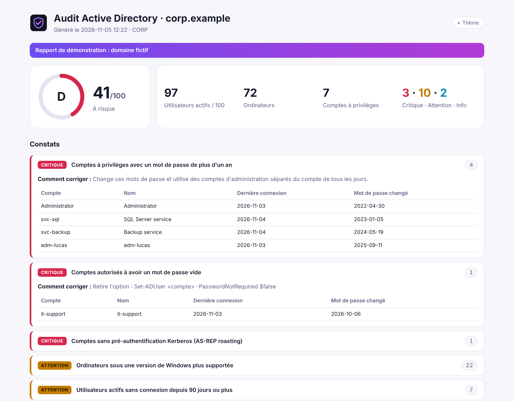

<div align="center">


# ad-audit-report

### Un bilan de santé de l'Active Directory, en lecture seule, sur une seule page HTML.

**Un seul script PowerShell. Rien à installer, aucun agent, aucun droit d'écriture.<br>Un score, les comptes à risque et comment les corriger, prêt à envoyer à ton responsable.**

[](https://github.com/B2ZO0/ad-audit-report/actions/workflows/ci.yml)
[](LICENSE)


[English](README.md) · **Français** · [Exemple de rapport](docs/sample-report.html)



<sub>Rapport de démonstration sur un domaine fictif (<code>-Demo</code>).</sub>

</div>

---

## Pourquoi ?

Avec le temps, tout Active Directory se remplit de comptes oubliés, d'administrateurs aux mots de passe vieux de dix ans et de comptes de service auxquels personne n'ose toucher. Les gros outils d'audit sont puissants, mais lourds, et leurs résultats sont difficiles à montrer à un responsable non technique.

`ad-audit-report` répond à une seule question, en une minute : **qu'est-ce que je dois ranger en premier, et comment ?**

## ✨ Ce qui est vérifié

| Gravité | Vérification |
|---|---|
| 🔴 Critique | Comptes à privilèges avec un mot de passe de plus d'un an |
| 🔴 Critique | Comptes autorisés à avoir un mot de passe vide (`PASSWD_NOTREQD`) |
| 🔴 Critique | Comptes sans pré-authentification Kerberos (AS-REP roasting) |
| 🔴 Critique | Compte Invité activé · contrôleurs de domaine sous un Windows plus supporté |
| 🟠 Attention | Utilisateurs et ordinateurs sans connexion depuis 90 jours (réglable) |
| 🟠 Attention | Mots de passe qui n'expirent jamais · comptes utilisateurs avec un SPN (Kerberoasting) |
| 🟠 Attention | Comptes désactivés encore dans des groupes à privilèges · trop de membres dans Admins du domaine |
| 🟠 Attention | Mot de passe de `krbtgt` vieux de plus de 180 jours |
| 🟠 Attention | Stratégie faible : longueur inférieure à 12, pas de verrouillage, pas de complexité |
| 🟠 Attention | Ordinateurs sous des versions de Windows sans correctifs de sécurité |
| 🔵 Info | Comptes jamais connectés · mots de passe qui expirent dans les 14 jours |

Chaque constat liste les comptes concernés et **comment corriger**, avec la commande quand il y en a une. Le rapport montre aussi la stratégie de mots de passe, les contrôleurs de domaine et tous les membres des groupes à privilèges (membres imbriqués compris).

**Fonctionne dans toutes les langues :** les groupes à privilèges sont trouvés par leur SID connu. *Admins du domaine* est donc audité exactement comme *Domain Admins*.

## 🚀 Démarrage rapide

Depuis un poste Windows du domaine avec le module ActiveDirectory (RSAT) :

```powershell
# Télécharger
Invoke-WebRequest https://raw.githubusercontent.com/B2ZO0/ad-audit-report/main/Invoke-ADAudit.ps1 -OutFile Invoke-ADAudit.ps1

# Lancer et ouvrir le rapport
.\Invoke-ADAudit.ps1 -Open
```

Un simple compte utilisateur du domaine suffit pour presque toutes les vérifications. Pas d'AD sous la main ? Essaie la démo :

```powershell
.\Invoke-ADAudit.ps1 -Demo -Language fr -Open
```

> Si PowerShell bloque le script, lance une fois `Unblock-File .\Invoke-ADAudit.ps1`, ou démarre-le avec `powershell -ExecutionPolicy Bypass -File .\Invoke-ADAudit.ps1`.

Il manque le module ActiveDirectory ?

```powershell
# Windows 10/11 (en administrateur)
Add-WindowsCapability -Online -Name Rsat.ActiveDirectory.DS-LDS.Tools~~~~0.0.1.0
# Windows Server
Install-WindowsFeature RSAT-AD-PowerShell
```

## ⚙️ Options

| Paramètre | Par défaut | Description |
|---|---|---|
| `-OutputPath` | dossier courant | Dossier ou fichier `.html` du rapport |
| `-InactiveDays` | `90` | Jours sans connexion avant qu'un compte soit « inactif » |
| `-ExpiringDays` | `14` | Signaler les mots de passe qui expirent dans ce nombre de jours |
| `-Server` | automatique | Contrôleur de domaine à interroger |
| `-Language` | langue de Windows | `en` ou `fr` |
| `-Csv` | non | Exporter aussi chaque constat et chaque compte en CSV |
| `-Open` | non | Ouvrir le rapport à la fin |
| `-Demo` | non | Domaine fictif, aucun AD nécessaire |

### Le lancer tous les mois

```powershell
$action  = New-ScheduledTaskAction -Execute 'powershell.exe' -Argument '-NoProfile -ExecutionPolicy Bypass -File C:\Scripts\Invoke-ADAudit.ps1 -OutputPath C:\Rapports -Csv'
$trigger = New-ScheduledTaskTrigger -Weekly -WeeksInterval 4 -DaysOfWeek Monday -At 7am
Register-ScheduledTask -TaskName 'Audit AD' -Action $action -Trigger $trigger -Principal (New-ScheduledTaskPrincipal -UserId SYSTEM -LogonType ServiceAccount)
```

Sur un serveur membre du domaine, la tâche tourne en SYSTEM : le compte ordinateur peut lire l'annuaire, aucun mot de passe à stocker.

## 🔒 Sécurité

- **Lecture seule.** Le script n'utilise que des commandes `Get-AD*`. Il ne modifie jamais rien dans l'Active Directory.
- **Rien ne sort de ton réseau.** Le rapport est un seul fichier HTML local, sans ressource externe.
- **Le rapport contient des noms de comptes.** Traite-le comme un document interne.

## ✈️ De la famille NetCockpit

De petits outils ciblés pour les admins, du débutant au pro, par l'auteur de [**NetCockpit**](https://github.com/B2ZO0/netcockpit), le cockpit en direct de toute ton infrastructure.

| Outil | Ce qu'il fait |
|---|---|
| [NetCockpit](https://github.com/B2ZO0/netcockpit) | Topologie en direct, VMware, switchs, alertes et journaux dans un seul cockpit |
| [ad-audit-report](https://github.com/B2ZO0/ad-audit-report) | Cet outil : bilan de santé de l'Active Directory |
| [ansible-debian-baseline](https://github.com/B2ZO0/ansible-debian-baseline) | Un serveur Debian prêt pour la production en un playbook |
| [netconfig-backup](https://github.com/B2ZO0/netconfig-backup) | Les configurations Cisco, FortiGate et UniFi versionnées dans Git |
| [sysadmin-toolbox](https://github.com/B2ZO0/sysadmin-toolbox) | Les outils PowerShell du quotidien pour les admins Windows |
| [proxmox-lab-terraform](https://github.com/B2ZO0/proxmox-lab-terraform) | Un lab de test complet sur Proxmox en une commande |

## 🤝 Contribuer

Une idée, un bug, une vérification qui manque ? [Ouvre un ticket](https://github.com/B2ZO0/ad-audit-report/issues). Les pull requests sont les bienvenues.

Si cet outil t'a fait gagner du temps, une ⭐ aide d'autres admins à le trouver.

---

<sub>Fait par [Enzo Marechal](https://enzomarechal.fr) ([@B2ZO0](https://github.com/B2ZO0)), administrateur système et réseau junior. Licence MIT.</sub>
