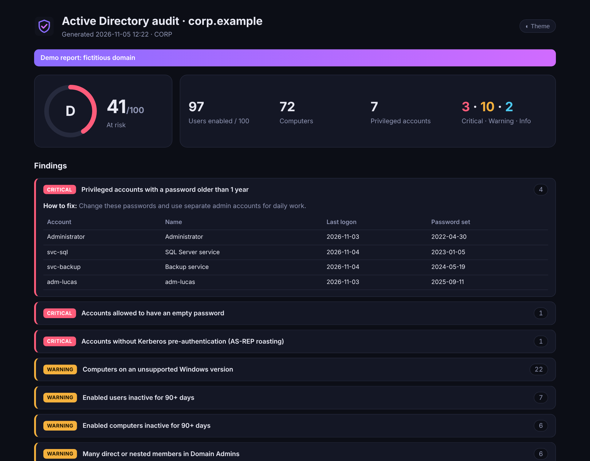

<div align="center">


# ad-audit-report

### A read-only Active Directory health check, in one HTML page.

**One PowerShell script. No install, no agent, no write access needed.<br>A score, the risky accounts and how to fix them, ready to send to your manager.**

[](https://github.com/B2ZO0/ad-audit-report/actions/workflows/ci.yml)
[](LICENSE)


[](https://github.com/B2ZO0/ad-audit-report/stargazers)

**English** · [Français](README.fr.md) · [Sample report](docs/sample-report.html)



<sub>Demo report on a fictitious domain (<code>-Demo</code>).</sub>

</div>

---

## Why?

Every Active Directory slowly fills up with forgotten accounts, admins with ten-year-old passwords and service accounts nobody dares to touch. Big audit tools are powerful but heavy, and their output is hard to show to a non-technical manager.

`ad-audit-report` answers one question in a minute: **what should I clean up first, and how?**

## ✨ What it checks

| Severity | Check |
|---|---|
| 🔴 Critical | Privileged accounts with a password older than 1 year |
| 🔴 Critical | Accounts allowed to have an empty password (`PASSWD_NOTREQD`) |
| 🔴 Critical | Accounts without Kerberos pre-authentication (AS-REP roasting) |
| 🔴 Critical | Guest account enabled · domain controllers on an unsupported Windows |
| 🟠 Warning | Users and computers inactive for 90+ days (configurable) |
| 🟠 Warning | Passwords that never expire · user accounts with an SPN (Kerberoasting) |
| 🟠 Warning | Disabled accounts still in privileged groups · crowded Domain Admins |
| 🟠 Warning | `krbtgt` password older than 180 days |
| 🟠 Warning | Weak policy: length below 12, no lockout, no complexity |
| 🟠 Warning | Computers on Windows versions without security updates |
| 🔵 Info | Accounts that never logged on · passwords expiring in the next 14 days |

Each finding lists the accounts concerned and **how to fix it**, with the command when there is one. The report also shows the password policy, the domain controllers and every member of the privileged groups (nested members included).

**Works in any language:** privileged groups are found by their well-known SID, so *Admins du domaine* or *Domänen-Admins* are audited just like *Domain Admins*.

## 🚀 Quick start

From a domain-joined Windows machine with the ActiveDirectory module (RSAT):

```powershell
# Download
Invoke-WebRequest https://raw.githubusercontent.com/B2ZO0/ad-audit-report/main/Invoke-ADAudit.ps1 -OutFile Invoke-ADAudit.ps1

# Run and open the report
.\Invoke-ADAudit.ps1 -Open
```

A standard domain user is enough for almost every check. No AD at hand? Try the demo:

```powershell
.\Invoke-ADAudit.ps1 -Demo -Open
```

> If PowerShell blocks the script, run `Unblock-File .\Invoke-ADAudit.ps1` once, or start it with `powershell -ExecutionPolicy Bypass -File .\Invoke-ADAudit.ps1`.

Missing the ActiveDirectory module?

```powershell
# Windows 10/11 (as administrator)
Add-WindowsCapability -Online -Name Rsat.ActiveDirectory.DS-LDS.Tools~~~~0.0.1.0
# Windows Server
Install-WindowsFeature RSAT-AD-PowerShell
```

## ⚙️ Options

| Parameter | Default | Description |
|---|---|---|
| `-OutputPath` | current folder | Folder or `.html` file for the report |
| `-InactiveDays` | `90` | Days without logon before an account is "inactive" |
| `-ExpiringDays` | `14` | Warn about passwords expiring within this many days |
| `-Server` | automatic | Domain controller to query |
| `-Language` | Windows language | `en` or `fr` |
| `-Csv` | off | Also export every finding and account to CSV |
| `-Open` | off | Open the report when done |
| `-Demo` | off | Fictitious domain, no AD needed |

### Run it every month

```powershell
$action  = New-ScheduledTaskAction -Execute 'powershell.exe' -Argument '-NoProfile -ExecutionPolicy Bypass -File C:\Scripts\Invoke-ADAudit.ps1 -OutputPath C:\Reports -Csv'
$trigger = New-ScheduledTaskTrigger -Weekly -WeeksInterval 4 -DaysOfWeek Monday -At 7am
Register-ScheduledTask -TaskName 'AD audit' -Action $action -Trigger $trigger -Principal (New-ScheduledTaskPrincipal -UserId SYSTEM -LogonType ServiceAccount)
```

On a domain-joined server, the task runs as SYSTEM: the computer account can read the directory, no password to store.

## 🔒 Safety

- **Read-only.** The script only uses `Get-AD*` cmdlets. It never changes anything in Active Directory.
- **Nothing leaves your network.** The report is a single local HTML file with no external resources.
- **The report contains account names.** Treat it like any internal document.

## ✈️ Part of the NetCockpit family

Small, focused tools for sysadmins, from beginners to pros, by the author of [**NetCockpit**](https://github.com/B2ZO0/netcockpit), a live cockpit for your whole infrastructure.

| Tool | What it does |
|---|---|
| [NetCockpit](https://github.com/B2ZO0/netcockpit) | Live topology, VMware, switches, alerts and logs in one cockpit |
| [ad-audit-report](https://github.com/B2ZO0/ad-audit-report) | This tool: Active Directory health check |
| [ansible-debian-baseline](https://github.com/B2ZO0/ansible-debian-baseline) | A production-ready Debian server in one playbook |
| [netconfig-backup](https://github.com/B2ZO0/netconfig-backup) | Cisco, FortiGate and UniFi configs, versioned in Git |
| [sysadmin-toolbox](https://github.com/B2ZO0/sysadmin-toolbox) | Everyday PowerShell tools for Windows admins |
| [proxmox-lab-terraform](https://github.com/B2ZO0/proxmox-lab-terraform) | A complete test lab on Proxmox in one command |

## 🤝 Contributing

Ideas, bugs, a check you would like to see? [Open an issue](https://github.com/B2ZO0/ad-audit-report/issues). Pull requests are welcome.

If this tool saved you some time, a ⭐ helps other admins find it.

---

<sub>Made by [Enzo Marechal](https://enzomarechal.fr) ([@B2ZO0](https://github.com/B2ZO0)), junior system and network administrator. MIT license.</sub>
